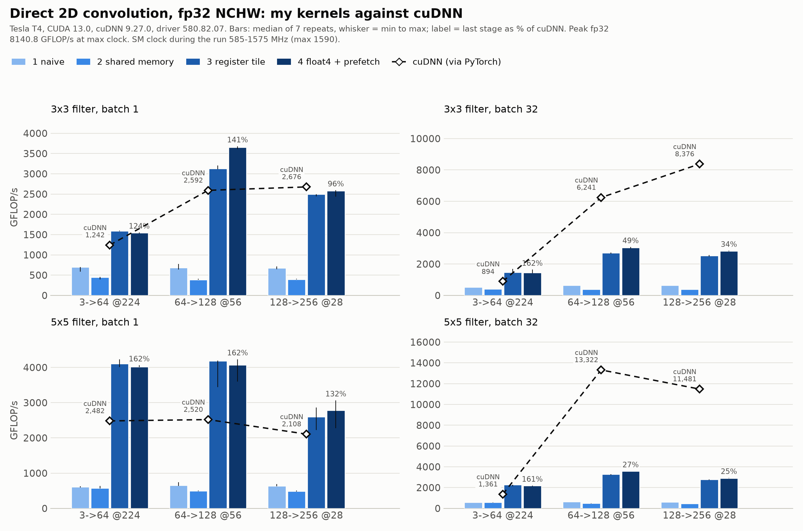
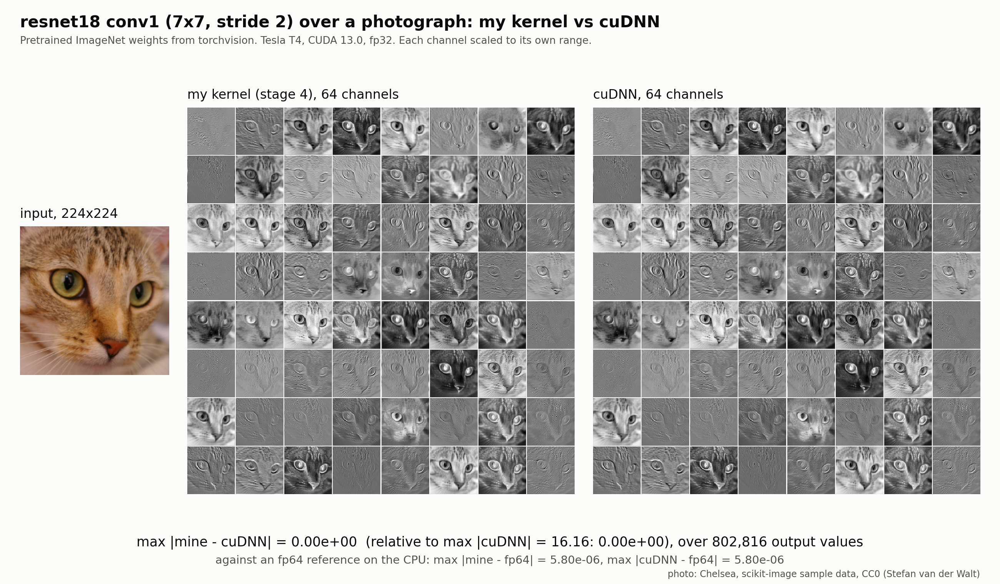

# cuconv

cuconv is a direct 2D convolution written in CUDA four times, each version
measured against cuDNN on the same inputs in the same process. I built it to
find out how much of a vendor library a hand-written kernel can reach on a
real card, and to be able to say exactly what is in the way of the rest.
The card is Google Colab's free Tesla T4; everything here ran there, and the
notebook reruns all of it.

The kernels do NCHW fp32 convolution with 3x3 and 5x5 filters on shapes that
look like CNN layers (3 to 64 channels at 224x224, 64 to 128 at 56x56, 128
to 256 at 28x28, batch 1 and 32), and the 7x7 stride-2 first layer of
resnet18 for the feature-map figure. The baseline is cuDNN reached through
PyTorch's `conv2d` with the cuDNN backend and autotuning on. That is
genuinely cuDNN underneath; I did not call the C API directly.

## the numbers

Tesla T4 on Colab, driver 580.82.07, CUDA 13.0, cuDNN 9.27.0, PyTorch
2.11.0+cu130, Nsight Compute 2025.3.1. GFLOP/s is the median of 7 timed
repeats of 20 launches each, after 10 discarded warm-up launches; the full
table with min-max ranges, milliseconds, clocks and power is in
[results/t4-20261102-2346/summary.md](results/t4-20261102-2346/summary.md),
and the raw numbers are in `bench.json` next to it. Every number counts a
multiply-add as two operations and uses the direct-convolution FLOP count
for cuDNN too, so "% of cuDNN" is a ratio of wall time.

| shape | cuDNN | 1 naive | 2 smem tile | 3 register tile | 4 float4 + prefetch | stage 4 vs cuDNN | stage 4 % of peak at its clock | SM MHz |
|---|---|---|---|---|---|---|---|---|
| 3->64 @224, 3x3, N=1 | 1,242 | 698 | 445 | 1,592 | 1,544 | 124% | 20% | 1545 |
| 64->128 @56, 3x3, N=1 | 2,592 | 682 | 387 | 3,128 | 3,654 | 141% | 47% | 1522 |
| 128->256 @28, 3x3, N=1 | 2,676 | 673 | 393 | 2,497 | 2,583 | 96% | 34% | 1500 |
| 3->64 @224, 3x3, N=32 | 894 | 533 | 410 | 1,475 | 1,446 | 162% | 47% | 600 |
| 64->128 @56, 3x3, N=32 | 6,241 | 650 | 390 | 2,715 | 3,049 | 49% | 58% | 1020 |
| 128->256 @28, 3x3, N=32 | 8,376 | 647 | 394 | 2,544 | 2,831 | 34% | 52% | 1065 |
| 3->64 @224, 5x5, N=1 | 2,482 | 608 | 577 | 4,103 | 4,021 | 162% | 56% | 1410 |
| 64->128 @56, 5x5, N=1 | 2,520 | 658 | 494 | 4,188 | 4,074 | 162% | 62% | 1282 |
| 128->256 @28, 5x5, N=1 | 2,108 | 638 | 489 | 2,602 | 2,786 | 132% | 43% | 1275 |
| 3->64 @224, 5x5, N=32 | 1,361 | 587 | 572 | 2,269 | 2,193 | 161% | 71% | 600 |
| 64->128 @56, 5x5, N=32 | 13,322 | 637 | 483 | 3,280 | 3,579 | 27% | 76% | 922 |
| 128->256 @28, 5x5, N=32 | 11,481 | 606 | 472 | 2,772 | 2,918 | 25% | 67% | 855 |

GFLOP/s throughout. "SM MHz" is the median clock sampled every 5 ms while
stage 4 was being timed; the card's maximum is 1590 and its power cap is
70 W. "% of peak at its clock" is against 40 SMs x 64 FMA lanes x 2 x that
clock, which is the peak the card could actually deliver at that moment.
Against the nameplate 8.1 TFLOP/s the best cell (3,654) is 45%.

What the table says:

- **At batch 1 my kernels beat cuDNN on five of six shapes**, by 1.2x to
  1.6x, and reach 96% on the sixth. cuDNN picks `implicit_convolve_sgemm`
  for every batch-1 shape and runs it at 25% to 31% achieved occupancy on
  the channel-heavy ones; a direct kernel with a 16-channel-by-8x32 block
  tile fills the card better.
- **On the 3-channel shapes I am 1.6x faster than cuDNN at both batch
  sizes.** Those shapes have 27 multiply-adds per output and are traffic
  bound: stage 4 reads at 61% to 70% of DRAM peak with L1 at 97%, which is
  about where a kernel that has to stream a 224x224x3 image and write
  64 channels back lands. Winograd and FFT do not pay for 3 input channels,
  so cuDNN has no algorithmic trick to play here.
- **At batch 32 on the channel-heavy shapes I reach 25% to 49% of cuDNN,
  and the gap is algorithmic, not a kernel defect.** cuDNN switches to
  Winograd F(4x4, 3x3) for the 3x3 cases and FFT for the 5x5 cases (the
  kernel names are in the profiler section), which do 2.25x and more fewer
  multiplies than a direct convolution, so its "GFLOP/s" in the table is
  the direct count it avoided. Its own GEMM core runs the FMA pipe at 81%
  to 89%. My stage 4 runs the same pipe at 71% to 90% and gets 52% to 76%
  of the fp32 peak at the clock the card held. On the 5x5 batch-32 shapes
  the two kernels are both at the FMA-pipe limit; cuDNN just has a quarter
  of the work.
- **The clock column matters more than I expected.** Under any kernel that
  keeps the FMA pipe busy the T4 hits its 70 W cap and drops to 585 to
  1100 MHz, so the 8.1 TFLOP/s on the box is not available to anyone;
  3.0 to 5.6 TFLOP/s is. cuDNN's kernels run at the same throttled clocks
  (its 5x5 FFT path was sampled at 585 MHz on the last shape). That also
  makes run-to-run spread mostly a clock story: see below.
- **Stage 2 is slower than stage 1 on every shape with more than three
  input channels.** The textbook shared-memory tile reloads the input tile
  for every output channel, its strided reads cost 0.36 bank conflicts per
  shared wavefront, and the naive kernel's reuse is served by L1 for free.
  I left it in because it is the honest middle of the progression.

### spread

Within a run, the min-max range across the 7 repeats is within 3% of the
median for most configurations; the exceptions are the batch-1 5x5 rows,
where the clock moved by up to 300 MHz between repeats (for example stage 3
on 64->128 @56: 3,437 to 4,197 GFLOP/s). Across two complete runs on the same
runtime eight minutes apart
([t4-20261102-2338](results/t4-20261102-2338/bench.json) and
[t4-20261102-2346](results/t4-20261102-2346/bench.json)), my kernels moved by
-1% to -11% and cuDNN by -3% to -24%, both tracking the clock the card
held as it warmed up through the session. The stage ordering and every
conclusion above are the same in both runs.

## what the profiler showed

Nsight Compute ran on the Colab T4 with hardware counters, so these are
measured. One launch per stage per shape; the full table, cuDNN's kernels
under the same counters, and the stall breakdowns are in the
[summary](results/t4-20261102-2346/summary.md#profiler). The channel-heavy
batch-32 rows, which are the ones that matter:

| shape | stage | achieved occupancy | FMA pipe | DRAM | L1 | bank conflicts / wavefront | FFMA share of instructions | top stalls |
|---|---|---|---|---|---|---|---|---|
| 64->128 @56, 3x3 | 1 naive | 90% | 11% | 1% | 96% | 0.00 | 0.17 | lg_throttle, long_scoreboard |
| | 2 smem tile | 100% | 15% | 0% | 91% | 0.36 | 0.09 | barrier, mio_throttle |
| | 3 register tile | 74% | 64% | 5% | 79% | 0.03 | 0.50 | barrier, wait |
| | 4 float4 + prefetch | 74% | 71% | 6% | 97% | 0.15 | 0.61 | mio_throttle, barrier |
| 64->128 @56, 5x5 | 1 naive | 85% | 11% | 0% | 95% | 0.00 | 0.22 | lg_throttle, long_scoreboard |
| | 2 smem tile | 100% | 13% | 0% | 99% | 0.38 | 0.17 | mio_throttle, barrier |
| | 3 register tile | 74% | 81% | 3% | 83% | 0.01 | 0.61 | not_selected, math_pipe_throttle |
| | 4 float4 + prefetch | 74% | 90% | 3% | 89% | 0.00 | 0.71 | not_selected, math_pipe_throttle |

Reading it stage by stage:

- **naive** is L1-bound: 96% L1 throughput, 11% FMA pipe, stalled on the
  load queue (`lg_throttle`). It moves 40 GB through L1 for a shape whose
  compulsory traffic is 7 MB. Occupancy is high and useless.
- **smem tile** trades L1 for shared memory and loses: 0.36 conflicts per
  wavefront from the `tx*S+kw` read pattern, `mio_throttle` and `barrier`
  on top, two barriers per input channel for 9 or 25 multiply-adds per
  thread. The FMA pipe never gets above 17%.
- **register tile** is the big step. The FMA pipe goes to 64% (3x3) and
  81% (5x5), DRAM and L1 stop mattering, bank conflicts are gone. But only
  44% to 62% of the instructions it issues are FFMAs; the rest are
  shared-memory loads (one per weight, one per input value) and the
  per-channel fill-and-barrier, and the top stalls are `barrier` and
  `long_scoreboard` on the 3x3 shapes. That is what told me what stage 4
  had to be: fewer instructions per multiply-add and a fill that overlaps
  the compute, not more occupancy and not less memory traffic.
- **float4 + prefetch** does that. FFMA share rises to 0.61 (3x3) and 0.71
  (5x5), the FMA pipe to 71% and 90%, and the ncu kernel times drop 10% to
  20% (5% to 17% in the throttled benchmark). The top stall on the 3x3
  shapes is now `mio_throttle`, the shared-memory pipe, which says the next
  step is a bigger micro-tile so each shared load feeds more FFMAs; on the
  5x5 shapes it is `math_pipe_throttle` and `not_selected`, which says the
  FMA pipe is the wall and the only lever left on this card is the clock.
  The 0.15 conflicts per wavefront are on the fill stores, where the
  multiple-of-four row stride that makes the `float4` reads legal costs a
  two-way conflict at row boundaries.

The first attempt at stage 4 (vectorised loads and four channels per
barrier, without the prefetch) cut instructions by 6% to 9% and changed
nothing in the benchmark, because the loads it removed were on the
shared-memory pipe, not the FMA pipe that was busy. The register prefetch
is what moved the number. Both attempts are in the history.

## where it fell short, and why

- **Winograd and FFT.** At batch 32 on the channel-heavy shapes cuDNN does
  2.25x (3x3) and more (5x5) fewer multiplies than any direct kernel can.
  Reaching 25% to 49% of its wall time while running the FMA pipe at 71% to
  90% means the remaining gap is the algorithm, and closing it means
  writing a Winograd kernel, which is a different project.
- **The power cap.** Every number above is at 585 to 1575 MHz, not 1590.
  A kernel that is good at keeping the FMA pipe busy is a kernel that
  pulls the clock down; stage 4's best throughput came at 922 MHz. Percent
  of nameplate peak tops out at 45%; percent of the peak at the sampled
  clock tops out at 76%.
- **Small grids at batch 1.** 128->256 @28 at batch 1 is 64 blocks for
  40 SMs, 1.6 waves, and achieved occupancy of 35% against a theoretical
  75%. It is the one batch-1 shape where I do not beat cuDNN (96%). A
  smaller row tile would launch more blocks and lose reuse; I did not
  chase it.
- **The 3-channel shapes are traffic bound** and stage 4 is slightly
  slower than stage 3 on them (-2% to -3%): one channel group means
  nothing to prefetch, and the weight-transpose launch is pure overhead.
- **Occupancy at 75%.** 76 to 79 registers per thread caps it at 3 blocks
  per SM. The profiler does not rank this as a problem (the stalls are not
  latency stalls), and squeezing to 64 registers would spill.

## the feature maps

resnet18's first convolution (64 filters, 7x7, stride 2, pretrained
ImageNet weights from torchvision) over a photograph, run with my stage 4
kernel and with cuDNN, all 64 output channels side by side. This is the
check that the kernel does what a real layer needs, not just what the
random-input test needs.

The two grids are not just visually identical; the max absolute difference
over the 802,816 output values is exactly 0: on this shape cuDNN's
`implicit_convolve_sgemm` and my kernel accumulate the 147 terms in the same
order. Because "identical to cuDNN" alone would be a weak proof, the figure
also compares both against an fp64 convolution on the CPU: each is 5.80e-6
from it, with a maximum output magnitude of 16.2.

### correctness, every shape

Every stage against cuDNN on random inputs, all twelve benchmark shapes plus
the resnet18 conv1 shape and two odd-sized shapes with partial tiles on every
edge, 15 shapes in all. Worst case per stage:

| stage | worst max abs err | worst max rel err |
|---|---|---|
| 1 naive | 5.424e-5 | 9.90e-6 |
| 2 smem tile | 5.424e-5 | 9.90e-6 |
| 3 register tile | 5.424e-5 | 9.90e-6 |
| 4 float4 + prefetch | 5.424e-5 | 9.90e-6 |

The worst case is the same for all four because it is the same shape
(128->256 @28, 5x5: 3,200 terms per output) and the same fp32 summation
order difference against cuDNN; relative error is against the largest
output magnitude. The per-shape table is in
[results/t4-20261102-2346/correctness.json](results/t4-20261102-2346/correctness.json).
## the four stages

Every stage is a separate file in `kernels/`, templated on filter size and
stride so the inner loops unroll, and reached through one PyTorch binding so
the benchmark can hand the same tensors to cuDNN and to each stage in one
process. All of them do NCHW fp32 cross-correlation with "same" padding;
all of them are compiled with `-O3 -lineinfo` for sm_75.

1. **naive** (`naive.cu`). One thread per output element. Every input and
   weight value comes from global memory in the innermost loop. 20
   registers, 100% theoretical occupancy, and the L1 cache does all the
   work: on the channel-heavy shapes it moves 40 GB through L1 for 7 GB of
   compulsory traffic.
2. **shared memory tile** (`smem.cu`). A 16x16 block computes a 16x16 tile
   of one output channel. Per input channel it loads the input tile plus
   halo and the 3x3 or 5x5 filter into shared memory, syncs, computes,
   syncs. This is the textbook step and on this card it is **slower than
   naive** on every shape with more than three input channels. The tile is
   reloaded for every output channel, so the input is staged 64 to 256
   times, and the profiler shows why that hurts: the strided reads
   `xs[(ty*S+kh)*IN_T + tx*S+kw]` produce 0.36 bank conflicts per shared
   wavefront, and the top stalls are `mio_throttle` and `barrier`. The
   naive kernel pays none of that because the hardware cache handles reuse
   for it.
3. **register tile** (`regtile.cu`). A 256-thread block computes 16 output
   channels over an 8x32 spatial tile; each thread owns a 4x4 micro-tile
   (4 channels x 4 columns) in registers. Per input channel and filter row
   a thread pulls one strip of input into registers and reuses each value
   4 times across columns and 4 times across channels, so most
   multiply-adds read registers. The shared row stride is padded to an odd
   number, which drops bank conflicts to 0.01 to 0.03 per wavefront. 76 to
   78 registers, 3 blocks per SM, 75% theoretical occupancy.
4. **float4 + prefetch** (`vec.cu`). Built from what Nsight Compute said
   about stage 3, see below. Weights are transposed once to
   `[Ci][K*K][Co]` (a 4 to 150 us kernel that is inside the timed region)
   so a thread's four channels come in as one `float4` shared load; input
   strips are read as `float4`s from a row stride that is a multiple of
   four; four input channels are staged per barrier instead of one; every
   tile index is computed once per block instead of once per channel; and
   the next channel group's global loads are issued into registers before
   the current group is computed, so they are in flight during the FFMAs.
   Turing has no `cp.async`, so this is the register-staged version of
   that pipeline.

## how I measured

`bench/bench.py` runs every stage and cuDNN on the twelve shapes in one
process, on the same random inputs. For each configuration: 10 warm-up
launches, discarded; then 7 repeats of 20 back-to-back launches between
CUDA events; the per-launch time is the mean inside a repeat, and the table
reports the **median across the 7 repeats with the min-max range in
brackets**. GFLOP/s counts a multiply-add as two operations and uses the
direct-convolution count (`2 N Co OH OW Ci K K`) for every stage *and for
cuDNN*, so when cuDNN runs Winograd or FFT the number is what it would have
cost to do directly, which is the fair denominator for "percent of cuDNN".

cuDNN is reached through `torch.nn.functional.conv2d` with
`cudnn.benchmark=True`, so it is cuDNN's own fastest algorithm for each
shape after autotuning, not a fixed one. I did not call the cuDNN C API
directly. `torch.profiler` records which kernels it actually launched;
the names are in the profiler section. TF32 is off (the T4 has none
anyway).

The T4 is power capped at 70 W and does not hold its 1590 MHz boost under a
kernel that keeps the FMA pipe busy. A thread samples the SM clock and
board power through NVML every 5 ms while each configuration is timed, and
the tables report the median clock it saw. "Percent of peak at clock" is
GFLOP/s against 40 SMs x 64 lanes x 2 x that clock. A five-second spin
before the first timed configuration brings the clock governor out of
idle; without it the first shape ran at 675 MHz.

The profiler pass (`bench/ncu_profile.py`) runs Nsight Compute on one
launch of every stage and of cuDNN for every shape, with
`--profile-from-start off` so the random-input kernels stay out of the
report. Hardware counters **were** available on the Colab T4, so the
occupancy, throughput, bank-conflict and stall numbers below are measured,
not estimated. The occupancy API numbers come from
`cudaOccupancyMaxActiveBlocksPerMultiprocessor` on each compiled instance.

## correctness

`bench/check.py` compares every stage against cuDNN on the twelve benchmark
shapes, on resnet18's conv1 shape (7x7, stride 2, pad 3), and on two
odd-sized shapes (37x53, 5 to 7 channels, strides 1 and 2) chosen so that
partial tiles land on every edge. It reports the max absolute error, the
max error relative to the largest output magnitude, and the mean absolute
error, and exits non-zero if any kernel exceeds 1e-3 absolute, which stops
`run.sh` before anything is benchmarked.

## reproducing it

Everything ran on Google Colab's free T4. `cuconv_t4.ipynb` clones this
repo, runs `run.sh`, shows both figures and zips `results/<label>/`.
Runtime > Change runtime type > T4, then Run all; about ten minutes. On
any machine with a CUDA GPU, PyTorch and ninja:

    bash run.sh mylabel

runs the correctness check, the benchmark, the profiler, the chart, the
feature-map figure and the markdown summary into `results/mylabel/`. The
numbers behind both figures are JSON next to them, so the chart can be
redrawn.

## layout

    kernels/common.cuh     shape struct, occupancy query, instance list
    kernels/naive.cu       stage 1
    kernels/smem.cu        stage 2
    kernels/regtile.cu     stage 3
    kernels/vec.cu         stage 4
    kernels/ext.cpp        PyTorch binding
    bench/common.py        shapes, FLOP count, device record, extension build
    bench/check.py         correctness against cuDNN
    bench/bench.py         timing, clock and power sampling
    bench/ncu_profile.py   torch.profiler kernel names, Nsight Compute metrics
    bench/ncu_target.py    what ncu runs
    bench/plot.py          the chart
    bench/featuremaps.py   the feature-map figure
    bench/report.py        results JSON -> summary.md
    run.sh                 one command
    cuconv_t4.ipynb        the Colab notebook
    results/<label>/       every number and figure from a run

The photograph in the feature-map figure is "Chelsea" from scikit-image's
sample data, released under CC0 by Stefan van der Walt. The resnet18
weights are torchvision's `ResNet18_Weights.IMAGENET1K_V1`.

